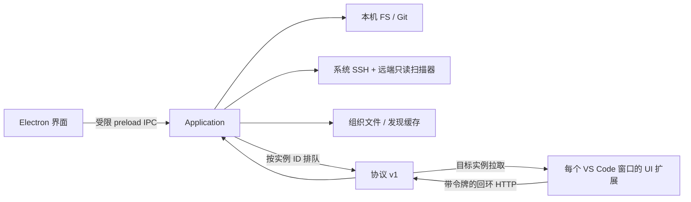

# 模型与实现边界

## 数据流

`src/core/domain.ts` 定义 Environment、Location、Checkout、Session、Workset 与操作状态。`application.ts` 负责查询、关联、缓存生命周期、组织和操作状态机；`persistence.ts` 独立保存组织数据及可重建发现缓存。`integrations/` 包含本机 Git/FS、SSH、VS Code URI/CLI 参数与本地协议适配；`desktop/` 封装系统对话框、打开目录、扩展安装和诊断；`presentation/` 是没有 Node 权限的界面。`extension/` 实现 VS Code API 和窗口命令。

## 身份与关系

- Environment 使用持久 UUID，独立于名称、连接目标、显式别名。账号与命名空间不自动合并。路径大小写规则创建后固定，默认区分大小写以避免误合并；本机和远端扫描先 realpath。
- Location ID = SHA-256(environment ID + NUL + 规范化完整路径)。路径由 POSIX 环境适配处理；同名、不同父目录或不同环境均不同。手动目录不要求 Git。
- Checkout 是 Location 的可选 Git 属性。`commonDir` 标识同环境中的仓库关系，独立于 checkout 的位置身份；`gitDir == commonDir` 为主 checkout，否则为关联 worktree。remote URL 只是元数据，不参与 checkout 身份。分支不存在时保留 detached/unborn 状态。
- 每次扩展激活生成 Session UUID，标题、当前文件、焦点变化不会改变它。一个 Session 对应一个窗口，包含任意数量的目录，可为空。Session 记录来源、工具版本、工具所在本机环境，以及其访问位置的环境。
- URI 只在 VS Code 适配路径使用。普通领域位置仍用 environment + path。未知 remote authority 保留在 `unresolved`，不会伪造环境。
- 目录与窗口是多对多；窗口关联 checkout 时用 ID 集合去重，同一 checkout 的两个窗口仍是两个会话。关联优先精确位置身份，再关联已知的最近 checkout 祖先；不会把整个同名仓库或同 remote URL 当作一个位置。
- 工作集是 Location ID 的集合，不包含 Session。加入工作集会将对应位置保留到组织数据，因此扫描替换、离线、关闭窗口或心跳过期都不会丢失用户组织。

## 生命周期和资源限制

发现默认最大深度 3，可配置 0–8，最多访问 15000 个目录。跳过隐藏子目录、node_modules 等；用户可显式把隐藏目录设为根。不会跟随遍历中的符号链接扩散。Git `worktree list --porcelain -z` 独立展开登记路径，所以外部或深层 worktree 不受根目录深度限制。缺失或损坏的登记进入诊断，不修复仓库。

一次扫描存在任何错误时合并已发现结果并保留旧缓存；只有完全成功时替换快照并更新 `lastSuccess`。因此部分失败不会错误地删除离线位置。界面将此状态标为错误，缓存不等同于实时存在性证明。

扩展每 2 秒报告并拉取请求。服务端用收到报告的时间更新 `lastConfirmed`；35 秒后过期、不计数且不可操作；350 秒后淘汰历史实例。正常退出会提前移除；崩溃/扩展重载由 TTL 收敛，最多存在 35 秒短暂重复计数。报告时间使用接收端时钟，不信任客户端心跳时间。

激活操作有效期 12 秒（打开新目录为 15 秒）；同一请求 ID 幂等、不能换目标。操作只在目标实例报告当前目录后投递一次，结果重复提交不覆盖终态。接收后网络中断可能意味着命令执行但回执丢失，此时超时，绝不凭空确认激活，也不重发造成重复副作用。操作终态保留 10 分钟便于解释。

## 持久化选择

首版用带 schema version 的小型 JSON 组织文件和独立缓存；单应用实例负责写入。临时文件使用唯一名、0600 权限，写入并 fsync 后原子 rename，避免进程崩溃留下半个 JSON。导入先完整验证再备份和替换。当前只有 schema v1，未知版本拒绝导入，不假装完成迁移。此规模下无需引入 SQLite ABI/二进制依赖；若后续出现大量历史数据再迁移。

## 安全边界

Electron 开启 context isolation、sandbox，关闭 Node integration，限制导航和新窗口；CSP 不允许网络脚本或页面网络访问。主进程只接受自身主 frame 的白名单动作。所有 OS 命令使用参数数组；SSH 的根目录通过 base64 JSON 配置传给固定脚本，不拼接任意 shell 命令。

HTTP 只监听随机 127.0.0.1 端口，32 字节随机令牌在用户私有文件，拒绝 Origin 和不合法 Host。扩展与桌面同属本机 OS 用户信任边界，不宣称隔离同用户的恶意进程。组织导出不含令牌、会话或操作。没有云服务、密码存储、跨工具插件框架或未实现工具界面。
