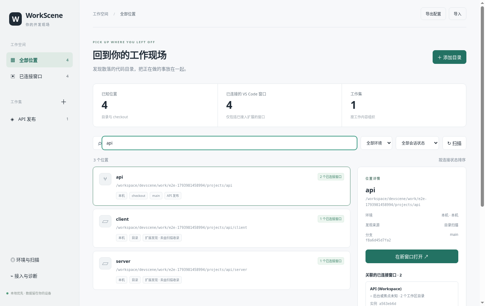

# 验证记录与复现

验证日期：2026-11-07（Asia/Shanghai；执行环境 UTC 为 2026-11-06）。验证平台：Linux x86_64，Node 24.22.1、Electron 40.10.6、TypeScript 5.9.3、官方 VS Code Stable 1.145.2。

## 自动化核心回归

`npm test`：15 项测试通过。测试位于 `src/tests/`，覆盖：

| 场景                                                     | 验证方式                                               |
| -------------------------------------------------------- | ------------------------------------------------------ |
| 同名目录、不同环境、显式大小写规则                       | 身份断言                                               |
| 主 checkout、外部 detached worktree、缺失登记、扫描边界  | 实际创建临时 Git 仓库与 worktree；比较扫描前后登记不变 |
| 多根窗口、同 checkout 多窗口、空窗口                     | 应用状态机测试；另有真实窗口验证                       |
| 未接入扩展、会话过期、退出、重载新实例                   | 可控时钟与报告输入；工作集保留                         |
| 目标消失、目录变化、重复请求、超时、重复回执、不支持能力 | 操作状态机测试                                         |
| activated 必须有最新焦点证据                             | 伪成功回执被降为 executed                              |
| SSH 失败与部分失败不清空缓存，成功空结果清空             | 发现适配器故障注入，非真实外部 SSH                     |
| SSH 扫描器读取真实 Git                                   | 在本机 Python 进程执行原样远端脚本，非 SSH 传输验证    |
| 工作集、导入导出、原子文件权限、导入清除旧缓存           | 实际临时文件与重载                                     |
| 接入令牌、Origin 拒绝、心跳、请求、结果和退出            | 实际 127.0.0.1 HTTP 服务                               |

`npm run format:check` 和 `git diff --check` 通过。`npm run package:extension` 生成可安装 VSIX。GitHub Actions 配置了 Ubuntu/macOS 核心测试与 macOS 构建；本地报告不提前声称远端 CI 已通过。

## 真实桌面端到端

在隔离 Xorg 显示与 xfwm4 窗口管理器中运行 `scripts/e2e.mjs`，使用 Playwright 控制实际 Electron 应用，安装构建的 VSIX 到官方 VS Code Stable 独立 profile。**没有模拟或伪造扩展报告。**

真实验证包括：

1. 未启动 VS Code 时显示尚未检测到有效会话。
2. 通过桌面表单添加目录、保存工作集，应用扫描实际 Git checkout 与外部 worktree。
3. 一个真实多根窗口打开同一 checkout 下的两个子目录，只统计一个关联窗口。
4. 第二个真实窗口打开同一 checkout，分别统计两个实例。
5. 将 WorkScene 置于前台后，按目标 Session ID 请求激活第一个窗口；扩展执行命令并报告 `activated`，观察到目标窗口焦点。
6. 第三个真实空窗口上报，目录列表为空。
7. 通过应用 `open` 动作调用实际 VS Code CLI，在新窗口打开外部 worktree；收到第四个真实会话后才计数。
8. 页面无 JavaScript 异常，保存首次使用与连接状态截图。
9. 关闭真实 VS Code 进程后，会话在 TTL 内收敛为零，工作集仍保留。

初次测试使用 `--extensionDevelopmentPath` 时 VS Code 复用了开发窗口，因此该次多窗口检查失败；测试已改为安装实际 VSIX 并通过。此失败属于测试启动方式，不被记录成产品多窗口通过证据。

端到端脚本生成 `work/e2e-<timestamp>/evidence.json`、`first-run.png`、`connected.png`、隔离用户配置和日志。不要公开整个测试配置目录，其中包含临时接入令牌；交付只复制截图与去敏的验证记录。

## 安装产物独立运行

`scripts/installed-smoke.mjs` 把 `release/linux-unpacked/` 复制到 `/tmp/workscene-installed-*/app/`，从无关目录启动。确认 `app.isPackaged === true`、运行资源来自该目录的 `app.asar`、内置 VSIX 存在、IPC 添加目录与持久化工作、界面无异常。证据在 `work/installed-evidence.json`。ASAR 只包含编译后的应用模块、界面、远端脚本与 package.json，不包含测试、开发配置、用户机器配置或开发者绝对路径。

macOS Intel 与 Apple Silicon 的 `.app` 和 ZIP 在 Linux 上交叉打包成功。**这不等于 macOS 实机启动、签名、公证或系统窗口焦点验证通过。**

## 尚未验证与目标机器验收

外部 SSH 主机、macOS 真机、Apple 签名/公证当前未验证。请在目标机器执行以下步骤：

1. **macOS 安装隔离**：把 `.app` 放入 `/Applications`，移开源码目录再启动。在诊断中确认 `packaged: true` 与数据目录；通过界面安装内置 VSIX。分别在 Intel/Apple Silicon 验收。
2. **路径与 worktree**：建立两个同名仓库，再用 `git worktree add --detach` 创建扫描根之外的 worktree。界面应显示独立位置、正确关系与 detached 分支。移走一个登记目录后只显示诊断，不修改 Git 登记。
3. **多窗口与跳转**：加载两个包含相同 checkout 的不同工作区，另开空窗口；确认实例数、目录关联及多根去重。切换文件不能改变实例。WorkScene 在前台时逐个点击明确窗口实例，确认确实返回该窗口。
4. **重载与失败**：执行 Developer: Reload Window，旧实例最多 35 秒内淘汰；关闭目标窗口后立即点击旧操作，应失败或超时，不能悄悄新开窗口。禁用扩展后只能显示未检测/过期，不能说确认无窗口。
5. **真实 SSH**：先通过系统 SSH 验证密钥、known_hosts、Git 和 Python 3；添加环境和明确别名，在 VS Code Remote SSH 打开目录。验证它只关联该环境，即使本机有同名同路径目录。不同账号新建环境，不能自动合并。
6. **断线**：成功扫描后断开 SSH，再扫描；应显示离线与原成功时间，保留目录与工作集。恢复连接后扫描正常。对存在的空根扫描成功可得到空结果；不存在根必须报错并保留缓存。
7. **导入导出**：将位置加入多个工作集，导出、修改后导入；检查关联与导入前备份。导入不会自动启动 SSH，旧发现缓存被清除，手动重新扫描。

验证记录中应注明系统/VS Code 版本、环境身份、真实或模拟方式、观察结果与限制；不得把上述待验收步骤当成已通过。

## 本次实际产物路径

开发仓库：`/workspace/devscene`。构建输出未提交到 Git（避免将运行时二进制加入源码历史）；验证证据与截图已纳入本仓库。

| 产物                     | 实际路径                                                    |
| ------------------------ | ----------------------------------------------------------- |
| Apple Silicon 未签名 ZIP | `/workspace/devscene/release/WorkScene-0.1.0-arm64-mac.zip` |
| Intel 未签名 ZIP         | `/workspace/devscene/release/WorkScene-0.1.0-mac.zip`       |
| VS Code 扩展             | `/workspace/devscene/release/workscene-connector.vsix`      |
| Linux 应用               | `/workspace/devscene/release/linux-unpacked/workscene`      |
| 最终真实窗口运行证据     | `/workspace/devscene/work/e2e-1793981458994/evidence.json`  |
| 最终独立安装运行证据     | `/workspace/devscene/work/installed-evidence.json`          |

可随源码审阅的证据：[真实窗口 JSON](evidence/real-vscode-windows.json)、[安装运行 JSON](evidence/installed-app.json)、[连接状态截图](evidence/connected.png)、[首次使用截图](evidence/first-run.png)。它们不含接入令牌或 SSH 凭据。

